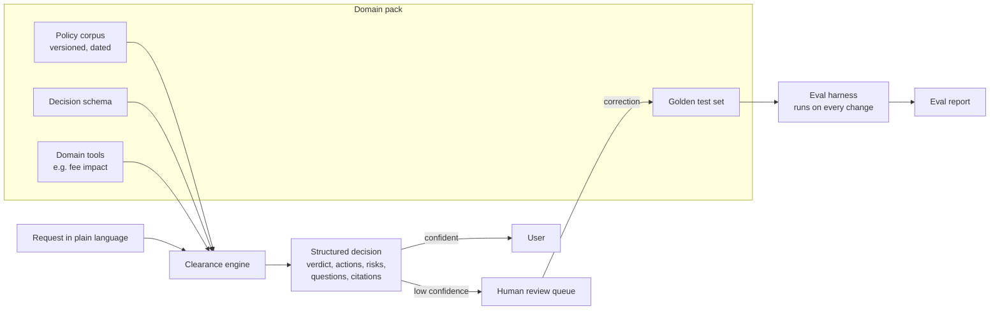

# Clearance

**Grounded clearance for business rules.** An eval-first AI decision copilot that checks a proposed business change against your written policies, cites every claim, and hands the decision to a human when it is not sure.

   

> **Status (October 2026):** project started. The product spec is in review; no code or results yet. This page is updated with every change, so what you read here is the real state of the project.

---

## Why this exists

In a marketplace, teams constantly want to launch new commercial rules: a markup, a new fee, a different payout schedule for suppliers. Before launch, someone has to answer four questions:

1. Is this allowed by our policies?
2. What does it change for Finance (which accounting events, which reports)?
3. What could break?
4. What is still undecided?

Today the answers live in scattered documents and in the heads of a few experts. The result is slow launches, long review queues for platform and Finance teams, and costly mistakes.

**Clearance gives a first answer in seconds, with sources, and knows when to stop.** It is decision support: a human always signs off.

## What it does

You describe a request in plain language:

> *"Add a 5% markup on activities sold through reseller partners, and pay those suppliers monthly instead of weekly."*

Clearance retrieves the relevant rules and returns a structured decision:

| Field | Example |
|---|---|
| **Verdict** | Clear with conditions |
| **Required actions** | Book the markup as separate revenue, not as part of the supplier price |
| **Risks** | Monthly payouts conflict with the onboarding rule for new suppliers |
| **Open questions** | Who carries the currency risk on cross-border payouts? |
| **Citations** | Every claim links to the exact policy section it comes from |
| **Confidence** | Low confidence triggers an escalation to a human reviewer |

## What makes it different from "yet another RAG demo"

| Principle | In practice |
|---|---|
| **Evals before code** | A labelled test set is written first. The system is built to pass it, and every change is re-scored automatically. |
| **Measure decisions, not prose** | Verdict accuracy, citation precision and recall, faithfulness to sources, and above all: does it escalate when it should? |
| **Adversarial by design** | The test set includes conflicting rules, outdated rule versions, missing rules and instructions hidden inside documents to manipulate the model. |
| **Architecture chosen on evidence** | Four approaches compared on the same test set: model only, full corpus in the prompt, retrieval (RAG), retrieval plus tools. The simplest one that meets the bar wins. |
| **Model choice on evidence** | Four models from three vendors (Anthropic, OpenAI, Google) compared on quality, cost per decision and latency. |
| **Human in the loop as a feature** | Escalations go to a review queue. Every human correction becomes a new test case, so the system improves with use. |
| **Generic core, pluggable domains** | One engine, many "domain packs". Adding a new domain means adding documents, cases and tools, not rewriting the engine. |

## Architecture (planned)

## Domain packs

| Pack | Question it answers | Status |
|---|---|---|
| **Commercial policy** (fictional experiences marketplace) | Can we launch this commercial rule, and what does it require from Finance? | Planned, first |
| **Freight matching** (fictional freight marketplace) | Can this carrier take this load on this lane at this price, given lane, hazardous-goods and cabotage rules? | Planned, second |

The second pack exists to prove the core is generic: the time it takes to add it will be measured and reported.

## Results

Nothing is measured yet. This table will hold the real numbers, model by model, as soon as the first eval run lands.

| Metric | Target | Result |
|---|---|---|
| Verdict accuracy | Defined in the spec | Not measured yet |
| Citation precision / recall | Defined in the spec | Not measured yet |
| Unsupported claim rate | Defined in the spec | Not measured yet |
| Escalation recall (escalates when it should) | Defined in the spec | Not measured yet |
| Cost per decision / latency | Reported per model | Not measured yet |

## Progress

- [x] Product framing and name
- [x] Repository with personal-data and secret guard from the first commit
- [ ] Product spec validated
- [ ] Commercial pack: fictional corpus and labelled test set
- [ ] Eval harness and baselines
- [ ] Architecture and model comparison
- [ ] Escalation calibration, review queue, feedback loop
- [ ] Freight pack (portability test)
- [ ] Live demo with cost controls
- [ ] Eval report, decision log, 3-minute walkthrough

## What this project demonstrates

Built solo, end to end, as a portfolio project for AI product leadership roles.

- **AI product judgment:** deciding where an LLM is useful, where it must stop, and proving it with numbers.
- **Evaluation design:** golden sets, adversarial cases, judge calibration against human labels, a held-out split to avoid overfitting.
- **Trade-off decisions:** architecture, model, cost and latency choices made on evidence and written down.
- **Trust and risk:** grounding, citations, escalation, prompt-injection resistance, data hygiene.
- **Platform thinking:** a generic core with pluggable domains, built for others to adopt.
- **Shipping:** spec, build, CI, deployment and documentation, owned by one person.

## Build log

| Date | Change |
|---|---|
| 2026-10-30 | Repository created: README, agent rules, license, personal-data and secret guard, README freshness check |

## Data and disclaimer

All companies, policies, people and figures in this repository are **fictional**. Any resemblance to real organisations is coincidental. Clearance is a decision-support tool, not legal, accounting or tax advice.

## Contributing and forking

Forks are welcome under the [MIT license](LICENSE). Contributor rules (for humans and AI agents) are in [AGENTS.md](AGENTS.md).

---

Built by [@ducharnesylvain](https://github.com/ducharnesylvain).
