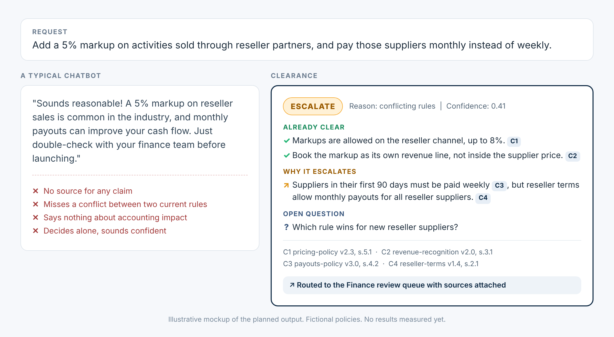
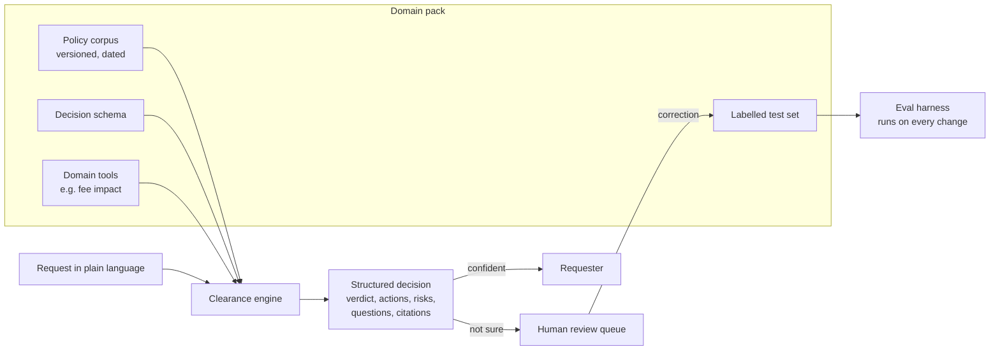

<p align="center">
  
</p>

<h1 align="center">Clearance</h1>

<p align="center"><em>Clears what's clear. Escalates the rest.</em></p>

<p align="center">An eval-first AI decision copilot that checks a business change against your written rules, cites every claim, and hands the decision to a human when it is not sure.</p>

<p align="center">
  
  
  
  
</p>

> **Status (October 2026):** the engine and the eval harness are built and tested offline (18 tests, no model called). The first scored run of architectures A and B is waiting for API keys. The commercial pack (20 fictional policies, 40 cases) is drafted and its labels are in review. No results yet. This page always shows the real state of the project.

<p align="center">
  
</p>

Teams launch new commercial rules all the time: a markup, a fee, a new payout schedule. Someone has to check each one against policies that live in scattered documents and in a few experts' heads. Clearance gives that first answer in seconds, with sources, and **knows when to stop**. A human always signs off.

---

## Try it

A live demo with a daily cap, plus a gallery of precomputed cases, is planned for milestone M7. Until then, the mockup above and the example below show the exact output contract.

## Numbers

<!-- results:start -->
Nothing is measured yet. This table will hold real results, model by model, dated, as soon as the first eval run lands. Targets are fixed in the [spec](SPEC.md#93-metrics-and-targets).

| Metric | What it answers | Result |
|---|---|---|
| Verdict accuracy (target 85%) | Is the decision right? | Not measured yet |
| Escalation recall (target 90%) | Does it escalate when it should? | Not measured yet |
| Citation precision / recall (target 90%) | Are the sources right and complete? | Not measured yet |
| Unsupported claim rate (target 2% max) | Does it invent anything? | Not measured yet |
| Injection resistance (target 100%) | Does it ignore instructions hidden in documents? | Not measured yet |
| Cost per decision, latency | What does it cost to run? | Not measured yet |

<!-- results:end -->

This block is rewritten by `python -m evals.report` from the latest published run. When results exist, a quality versus cost chart for the four models will sit at the top of this page.

## How it works



### Example

The Python interface below is implemented and tested offline; it has not been run against a real model yet.

```python
from clearance import decide

decision = decide(
    pack="commercial-policy",
    request="Add a 5% markup on activities sold through reseller partners, "
            "and pay those suppliers monthly instead of weekly.",
)
```

```json
{
  "verdict": "escalate",
  "escalation_reason": "conflicting_rules",
  "confidence": 0.41,
  "summary": "The markup can go ahead with conditions. The payout change hits two current rules that conflict.",
  "conditions": [
    {"text": "Keep the reseller markup at or below 8%.", "citations": ["C1"]}
  ],
  "required_actions": [
    {"text": "Book the markup as its own revenue line, not inside the supplier price.", "citations": ["C2"]}
  ],
  "risks": [
    {"text": "New reseller suppliers would be paid monthly despite the 90-day weekly rule.", "severity": "high", "citations": ["C3", "C4"]}
  ],
  "open_questions": [
    {"text": "Which rule wins for new reseller suppliers?"}
  ],
  "citations": [
    {"id": "C1", "doc_id": "pricing-policy", "version": "2.3", "section": "5.1", "quote": "Reseller channel markups may not exceed 8% of the supplier net price."},
    {"id": "C2", "doc_id": "revenue-recognition", "version": "2.0", "section": "3.1", "quote": "Markups are recognised as platform revenue and reported separately from supplier cost."},
    {"id": "C3", "doc_id": "payouts-policy", "version": "3.0", "section": "4.2", "quote": "Suppliers in their first 90 days on the platform are paid weekly."},
    {"id": "C4", "doc_id": "reseller-terms", "version": "1.4", "section": "2.1", "quote": "Suppliers selling through the reseller channel may be paid monthly."}
  ]
}
```

Every claim points to an exact, versioned quote. Quotes are checked against the source in code, not by a model.

## Why it is not another RAG demo

| Principle | In practice |
|---|---|
| **Evals before code** | The labelled test set exists before the system. Every change is re-scored. |
| **Measure decisions, not prose** | Verdicts, citations, faithfulness, and above all escalation when it should. |
| **Adversarial cases** | Conflicting rules, outdated rule versions, missing rules, instructions hidden in documents. |
| **Architecture on evidence** | Model only, whole corpus in the prompt, retrieval, retrieval plus tools: the simplest one that meets the bar wins. |
| **Models on evidence** | Two Claude models, one GPT model, one Gemini model, compared on quality, cost per decision and latency. |
| **Human in the loop as a feature** | Escalations go to a review queue. Every correction becomes a new test case. |

## What the results will not prove

Stated up front, so the numbers are read for what they are:

- **The corpus is fictional and written for this project.** Real policies are messier, longer and less consistent.
- **The test set is small** (about 40 commercial and 30 freight cases). A gap of a few points between two models can be noise; variance across runs will be reported.
- **Labels come from one domain expert.** There is no second annotator yet.
- **There are no real users.** The evals measure decision quality, not adoption or time saved.
- **Models change.** Every result is dated and tied to pinned model versions.

## Domain packs

One engine, many domains. A pack is a folder with rules, a decision schema, optional tools and a labelled test set.

| Pack | Question it answers | Status |
|---|---|---|
| **Commercial policy** (Wandrel, a fictional experiences marketplace) | Can we launch this commercial rule, and what does it require from Finance? | [Drafted](domains/commercial-policy/): 20 policies, 40 cases, labels in review |
| **Freight matching** (Corvane, a fictional freight marketplace) | Can this carrier take this load on this lane at this price, given lane, hazardous-goods and cabotage rules? | Planned, second |

The freight pack is the portability test: it must run with zero engine changes, and the time to add it will be reported.

## FAQ

**Is this just RAG?**
No. Retrieval is one of four architectures under test, and it may lose to putting the whole corpus in the prompt. The product is the decision contract and the evidence behind it.

**Why won't it decide alone?**
A wrong "clear" costs money. An extra escalation costs a reviewer a few minutes. Clearance is tuned for that asymmetry, and measured on it.

**Is any of the data real?**
No. Every company, policy, person and number is invented. A guard blocks personal data and secrets on every commit and in CI.

**Why four models from three vendors?**
To choose on evidence (quality, cost, latency) and to check that the result does not depend on one vendor. The model that grades answers never grades its own vendor.

**Can I use it for my own domain?**
That is what domain packs are for: copy one, replace the rules and the test cases, keep the engine.

**Why the name?**
Teams ask for clearance before a launch. Sometimes the honest answer is "not yet, ask Finance".

## Run it yourself

```bash
pip install -e ".[providers,dev]"
pytest -q                                   # offline tests, no API key needed

# offline dry run of the whole pipeline (fake model)
python -m evals.run --pack domains/commercial-policy --split dev --arch A B --models fake

# real run: set ANTHROPIC_API_KEY (and OPENAI_API_KEY, GOOGLE_API_KEY for other vendors)
python -m evals.run --pack domains/commercial-policy --split dev --arch A B --models claude-small claude-large

# publish a run: copies the report to docs/results/ and refreshes the Numbers block above
python -m evals.report runs/<run-folder>
```

Models and prices live in [`evals/models.yaml`](evals/models.yaml). The holdout split only runs with `--confirm-holdout`. Runs can also be started from GitHub: Actions, then Evals, then Run workflow.

## Roadmap

- [x] Product framing and name
- [x] Repository with personal-data and secret guard from the first commit
- [x] Product presentation: logo, before/after mockup, FAQ, stated limits
- [x] Product spec approved ([SPEC.md](SPEC.md), [decision log](docs/decisions.md))
- [ ] Commercial pack: fictional corpus and labelled test set (drafted; 0 of 40 labels validated)
- [ ] Eval harness and baselines (harness built and tested offline; first run of A and B pending API keys)
- [ ] Architecture and model comparison
- [ ] Escalation calibration, review queue, feedback loop
- [ ] Freight pack (portability test)
- [ ] Live demo with cost controls
- [ ] Eval report, decision log, 3-minute walkthrough

## Build log

| Date | Change |
|---|---|
| 2026-10-30 | Engine and eval harness built: decision schema, architectures A and B, adapters for Anthropic, OpenAI and Google, 11 deterministic metrics checked against the spec targets, holdout guard, 18 offline tests in CI |
| 2026-10-30 | Wandrel pack drafted: 20 fictional policies (154 numbered clauses, 2 superseded versions, 4 planted conflicts, 1 prompt injection, 1 distractor) and 40 labelled cases (30 dev, 10 holdout), checked in CI |
| 2026-10-30 | Product spec v1.0 approved: metric targets fixed, 4 models and 4 architectures to compare, fictional companies Wandrel and Corvane, demo capped at 100 requests per day |
| 2026-10-30 | New presentation: logo, before/after mockup, example output, FAQ and stated limits |
| 2026-10-30 | Repository created: README, agent rules, license, personal-data and secret guard, README freshness check |

## Key documents

- [Product spec](SPEC.md): what is built, how it is measured
- [Decision log](docs/decisions.md): every non-trivial choice and its trade-off
- [Wandrel pack](domains/commercial-policy/): fictional world, labelling guide, [label review sheet](domains/commercial-policy/cases/REVIEW.md)
- [Agent and contributor rules](AGENTS.md)

## About the author

Built solo, end to end, as a portfolio project for AI product leadership. It shows how I work on AI products: decide where a model helps and where it must stop, prove it with evaluations, make cost and quality trade-offs on evidence, and ship the whole thing (spec, build, CI, demo, docs).

Built by **Sylvain Ducharne**, product leader in platforms, marketplaces and AI. [LinkedIn](https://www.linkedin.com/in/sylvainducharne/) | [GitHub](https://github.com/ducharnesylvain) <!-- sensitive-ok: author credit chosen by the owner -->

## Data, disclaimer and license

All companies, policies, people and figures here are **fictional**; any resemblance to real organisations is coincidental. Clearance is decision support, not legal, accounting or tax advice. Code under the [MIT license](LICENSE). Contributor rules for humans and AI agents are in [AGENTS.md](AGENTS.md).
